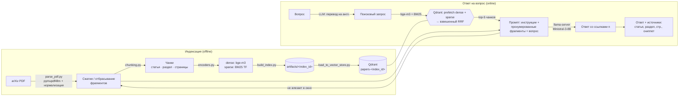

# RAG по научным статьям о диффузионных моделях — проектный документ

Документ описывает устройство RAG-агента из лабораторной работы №2: какие решения приняты на каждом
шаге конвейера, почему именно такие, как они проверялись и что нужно сделать, чтобы довести систему
до эксплуатации. Краткий отчёт о лабораторной — в [README.md](README.md).

**Содержание**

1. [Задача и требования](#1-задача-и-требования)
2. [Корпус и набор вопросов](#2-корпус-и-набор-вопросов)
3. [Архитектура](#3-архитектура)
4. [PDF → Markdown](#4-pdf--markdown)
5. [Разбиение на чанки](#5-разбиение-на-чанки)
6. [Векторизация](#6-векторизация)
7. [Артефакты и повторные запуски](#7-артефакты-и-повторные-запуски)
8. [Векторное хранилище Qdrant](#8-векторное-хранилище-qdrant)
9. [Поиск](#9-поиск)
10. [Методика оценки](#10-методика-оценки)
11. [Результаты retrieval и выбор конфигурации](#11-результаты-retrieval-и-выбор-конфигурации)
12. [Генерация ответа](#12-генерация-ответа)
13. [Качество ответов](#13-качество-ответов)
14. [Ограничения и путь в эксплуатацию](#14-ограничения-и-путь-в-эксплуатацию)
15. [Эксплуатация: команды](#15-эксплуатация-команды)

---

## 1. Задача и требования

Пользователь задаёт вопрос (по-русски или по-английски) о содержании четырёх научных статей;
система находит релевантные фрагменты и отвечает с цитатами: статья, раздел, страница, дословный
сниппет.

| Требование | Как выполнено |
|---|---|
| Корпус ≥ 50 страниц, 10–20 вопросов | 4 статьи arXiv, 53 страницы, ~19.5 тыс. слов; 18 вопросов с эталоном |
| Нормализованный Markdown с метаданными | `parse_pdf.py`: YAML-шапка, заголовки по нумерации разделов, маркеры страниц |
| Конфигурируемое разбиение и эмбеддинги | `config.py`: флаги CLI → переменные `RAG_*` → значения по умолчанию |
| Пересборка без ручной очистки, версионирование | каталог артефактов и коллекция именуются по параметрам; хэш корпуса |
| Qdrant, HNSW, квантование, переиндексация | `load_to_vector_store.py`: `--hnsw-m`, `--ef-construct`, `--quantization`, `--drop-and-reindex`, `--reset` |
| Идемпотентность | детерминированные id точек, проверка метаданных коллекции, пропуск записи для актуальной коллекции |
| Recall@k, Precision@k, MRR; ≥ 2–3 конфигурации | `evaluate.py`: 18 конфигураций × 2 языка + 5 вариантов HNSW |
| RAG с LLM из лабораторной №1 и цитатами | `rag.py`: Ministral-3-8B в llama-server; CLI, диалог, HTTP `POST /ask` |

Нефункциональные ограничения: всё работает локально на одной машине (Ryzen 9 9950X, 64 GB RAM,
RTX 5070 12 GB), без Docker и прав root, без внешних API.

## 2. Корпус и набор вопросов

### 2.1. Статьи

| Статья | arXiv | Стр. | Слов после очистки | Тема |
|---|---|---|---|---|
| Direct3D: Scalable Image-to-3D Generation via 3D Latent Diffusion Transformer | [2405.14832](https://arxiv.org/abs/2405.14832) | 15 | 4 673 | генерация 3D-формы по изображению: триплановый VAE + DiT |
| ViewCrafter: Taming Video Diffusion Models for High-fidelity Novel View Synthesis | [2409.02048](https://arxiv.org/abs/2409.02048) | 13 | 7 698 | новые ракурсы сцены: видео-диффузия, обусловленная облаком точек |
| DreamPainter: Image Background Inpainting for E-commerce Scenarios | [2508.02155](https://arxiv.org/abs/2508.02155) | 13 | 4 092 | генерация фона для товара по тексту и референсу |
| Preserving Product Fidelity in Large Scale Image Recontextualization with Diffusion Models | [2503.08729](https://arxiv.org/abs/2503.08729) | 12 | 3 069 | дообучение под товар с синтетической аугментацией |

Корпус тематически связан (диффузия, 3D, товарные изображения), поэтому статьи конкурируют за
одни и те же запросы: «LoRA», «novel view», «DINO», «CLIP» встречаются в нескольких работах —
это делает retrieval нетривиальным даже на маленьком корпусе.

### 2.2. Вопросы и эталон — `source/questions.json`

18 вопросов: по 4 на статью и 2 межстатейных («в каких работах используется LoRA и для чего?»).
Вопросы покрывают разные типы информации: архитектуру (Q01, Q03, Q05), определения (Q02),
гиперпараметры и числа (Q04, Q08, Q11), алгоритмы (Q07), результаты экспериментов (Q15, Q16),
абляции (Q12), сравнение работ (Q17, Q18).

У каждого вопроса:

| Поле | Назначение |
|---|---|
| `question` / `question_en` | формулировка на русском и её английский перевод |
| `sources` | arXiv id статей, где есть ответ |
| `evidence` | 1–3 дословные фразы из статьи, подтверждающие ответ — эталон для retrieval |
| `answer_keys` | ключевые факты (числа, названия), которые должны появиться в ответе |
| `reference` | эталонный ответ для ручной проверки |

Почему эталон — фразы, а не id чанков: id меняются при каждом изменении `chunk_size`, `overlap` или
сплиттера, а фраза остаётся. Это позволяет сравнивать любые разбиения одним эталоном (подробнее —
в [разделе 10](#10-методика-оценки)). Перед каждой оценкой `evaluate.py` проверяет, что каждая фраза
находится хотя бы в одном чанке, — опечатка в эталоне или поломка парсера сразу останавливает прогон.

Почему два языка: пользователи пишут по-русски, а корпус англоязычный. Это главный практический
вызов системы, и он влияет на выбор модели эмбеддингов сильнее, чем любой другой параметр.

## 3. Архитектура



| Модуль | Ответственность |
|---|---|
| `config.py` | корпус, пути, реестр моделей, `IndexConfig` (параметры индекса и их имя), CLI-флаги |
| `parse_pdf.py` | скачивание PDF, конвертация в Markdown, нормализация, YAML-шапка |
| `chunking.py` | сплиттеры LangChain (разделы h1–h3 + окно в токенах), восстановление раздела и страниц чанка |
| `encoders.py` | dense-эмбеддинги (sentence-transformers), BM25-веса документа и запроса |
| `build_index.py` | чанки + эмбеддинги → `artifacts/<index_id>/`, проверка актуальности |
| `load_to_vector_store.py` | схема коллекции, загрузка, проверка параметров, переиндексация, сброс |
| `retriever.py` | dense / sparse / hybrid-поиск, перевод запроса |
| `context_budget.py` | размер окна LLM, точный подсчёт токенов промпта, сжатие и отбрасывание фрагментов, ошибки llama-server |
| `rag.py` | промпт, проверка бюджета, вызов LLM, разбор цитат, сниппеты; CLI, диалог, HTTP-сервис |
| `evaluate.py`, `evaluate_qa.py`, `plot_results.py` | метрики retrieval, качество ответов, график |

Внешние процессы: Qdrant 1.20 (порт 6333) и llama-server из лабораторной №1 (порт 8080). Оба —
готовые бинарники, запускаются без Docker и root.

## 4. PDF → Markdown

### 4.1. Выбор конвертера

| Вариант | Наблюдение | Решение |
|---|---|---|
| `pdftotext -layout` (poppler) | на двухколоночной вёрстке ViewCrafter строки левой и правой колонки склеиваются в одну: «…such as NeRF [1] and 3D-GS [2], their dependence on dense synthesis of generic scenes from single or sparse images…» | не подходит |
| `pdftotext` без `-layout` | колонки разделены, но нет заголовков, таблиц, разметки | не подходит |
| docling / marker | структурный разбор и формулы, но тянут модели на сотни МБ–ГБ и долгий разбор | избыточно для 4 статей |
| **pymupdf4llm 1.28.2** | правильно читает колонки, распознаёт заголовки и таблицы в Markdown, работает за секунды | **выбран** |

Отдельная находка: на PyPI опубликован `pymupdf4llm 2.0` — **пустой пакет** (только `dist-info`,
без кода и метаданных). `pip install pymupdf4llm` ставит именно его, и импорт падает. Поэтому версия
закреплена: `pymupdf4llm==1.28.2`, `pymupdf==1.28.2`.

### 4.2. Нормализация

pymupdf4llm назначает уровень заголовка по размеру шрифта, и уровни скачут: в одной статье «1
Introduction» — `##`, в другой — `#`, а подразделы Preserving Product Fidelity оказываются на одном
уровне с разделами. Уровень восстанавливается **по номеру раздела**:

| Заголовок | Уровень |
|---|---|
| название статьи (из реестра `config.PAPERS`) | `#` |
| `3 Methods`, `A Appendix`, `Abstract`, ненумерованные | `##` |
| `3.1 …`, `A.1 …` | `###` |
| `2.1.1 …`, `A.2.1 …` | `####` |

Что ещё делает `parse_pdf.py`:

- **заголовки приложений, распознанные как пункты списка** (`- A.1 SYNTHETIC AUGMENTATION TECHNIQUES`
  в Preserving Product Fidelity), возвращаются в заголовки;
- **маркеры страниц** `<!-- page: N -->` перед каждой страницей — по ним чанк получает номера страниц;
- **удаляются**: колонтитулы с номером страницы, боковая метка `arXiv:2405.14832v2 [cs.CV] …`,
  дубль названия статьи, `<sup>`-сноски авторов;
- **удаляется список литературы**: 60–80 библиографических записей на статью выигрывают у
  содержательного текста по BM25 («diffusion», «3D», «image» в каждом названии), а ответа ни на
  какой вопрос пользователя в них нет. Приложения после литературы сохраняются;
- **удаляется «текст картинок»** — подписи узлов диаграмм, извлечённые из рисунков
  («Learnable Tokens<br>Transformer Encoder<br>Network…»). Это бессвязный набор слов, который
  попадал в выдачу и в контекст LLM. Подписи `Figure N: …` остаются — в них нормальный текст;
- исправляются артефакты курсива: `0 _._ 6` → `0.6`, `_×_` → `×`.

YAML-шапка каждого файла:

```yaml
title: "Direct3D: Scalable Image-to-3D Generation via 3D Latent Diffusion Transformer"
short: "Direct3D"
authors: "Shuang Wu, Youtian Lin, …"
arxiv_id: "2405.14832"
url: https://arxiv.org/abs/2405.14832
source: data/pdf/2405.14832.pdf
published: 2024-05-23
parsed: 2026-10-23
pages: 15
parser: pymupdf4llm 1.28.2
```

### 4.3. Известные дефекты парсинга

- **Формулы теряют двумерную вёрстку.** Дробь `s = 1/512` из Direct3D превращается в `s = 5121`,
  и LLM честно пересказывает «порог s = 5121». Для корпуса, где важны формулы, нужен парсер с
  распознаванием математики (Nougat, marker) — см. [раздел 14](#14-ограничения-и-путь-в-эксплуатацию).
- **Буквица** в начале введения ViewCrafter («NOVEL view synthesis…») разрывает первую строку:
  «N visionOVEL viewand synthesisgraphics…». Затронуто одно предложение.
- **Диакритика** в ViewCrafter извлекается отдельным символом: «Plücker» → «Pl¨ucker». Dense-модели
  это почти не мешает, но BM25 не сопоставит такой термин с «Plücker» в запросе.
- Сложные таблицы с совмещёнными графиками (DreamPainter, табл. 4a + рис. 4b) склеиваются в одну
  таблицу с лишними столбцами; числа при этом сохраняются.

## 5. Разбиение на чанки

### 5.1. Сплиттеры — `chunking.py`

Используются готовые сплиттеры из **langchain-text-splitters 1.1**:

| Режим | Как режется |
|---|---|
| `markdown` | `MarkdownHeaderTextSplitter` делит статью на разделы h1–h3 (h4 остаются внутри родительского h3, название раздела — в метаданных `h2`/`h3`), затем каждый раздел длиннее `chunk_size` режется `RecursiveCharacterTextSplitter` |
| `recursive` | `RecursiveCharacterTextSplitter` по всей статье сразу; строки заголовков остаются в тексте, раздел чанка — последний заголовок h2/h3 перед его началом |

`RecursiveCharacterTextSplitter` создаётся через `from_huggingface_tokenizer`: длина и `chunk_overlap`
считаются в токенах **одного токенизатора для всех конфигураций** (`BAAI/bge-m3`, SentencePiece
от XLM-R), чтобы `chunk_size = 400` означал одно и то же для любой модели эмбеддингов.
Разделители по убыванию приоритета: `"\n\n"`, `"  \n"`, `"\n"`, `". "`, `" "`, `""`. Второй из них
нужен из-за особенности `MarkdownHeaderTextSplitter`: он склеивает строки раздела через `"  \n"`
(markdown-перенос), и пустые строки между абзацами пропадают. Без этого разделителя граница абзаца
не отличалась бы от переноса строки внутри таблицы.

`keep_separator="end"`: разделитель остаётся в конце куска, к которому относится. По умолчанию
(`"start"`) LangChain приклеивает его к началу следующего куска, и при разрезе по `". "` точка
уезжала в следующий чанк: «…hidden dimension 64» / «. The geometric mapping network…». До
исправления так начинались 54 из 263 чанков при 200 токенах и 2 из 132 при 400; итоговые чанки
по 800 токенов это не затрагивало — там разрез по `". "` не понадобился. Метрики после
исправления: при 200 токенах MRR на русских вопросах 0.421 → 0.495, R@5 на английских
0.750 → 0.722; `recursive` 400 — R@5 на русских 0.769 → 0.796; итоговая конфигурация не изменилась.

**Номера страниц.** Маркеры `<!-- page: N -->` проходят через оба сплиттера как обычные строки.
Для каждого чанка ищется его положение в исходном тексте раздела, страницы чанка — страница перед
его началом плюс все маркеры внутри. После этого маркеры вырезаются из текста. Страница начала
раздела переносится из предыдущего раздела.

Положение чанка ищется **по его первой и последней строке**, а не через встроенный
`add_start_index`. При склейке кусков через разделитель текст чанка у LangChain не всегда точная
подстрока исходного, и `add_start_index` возвращает −1. Так чанк с «50 steps of DDIM» сначала
получил страницу 7 вместо 8. Проверка после исправления: для каждой строки каждого чанка
(≈300 на конфигурацию) её страница в Markdown входит в страницы чанка. Исключения — 3–5 строк,
дословно повторяющихся в статье дважды: проверка находит первое вхождение, а чанк относится ко
второму.

**Overlap у LangChain работает кусками.** `RecursiveCharacterTextSplitter` переносит в следующий
чанк только целые куски последнего уровня разбиения (обычно абзацы), если они помещаются в
`chunk_overlap`. Абзацы научных статей — 100–250 токенов, поэтому при `overlap = 60` перекрытие есть
лишь у 15 из 67 пар соседних чанков одного раздела, при `overlap = 100` на чанках 800 — у 10 из 19.
Разбиение 400/0 и 400/60 почти совпадает (130 и 132 чанка), и метрики на английских вопросах у них
одинаковы ([раздел 11.2](#112-разбиение)).

### 5.2. Заголовки в тексте чанка

С флагом `--headers` (по умолчанию) в текст для векторизации добавляется строка контекста:

```
Direct3D | 4 Experiments > 4.1 Implementation Details
D3D-DiT. Our diffusion model adopts the network configuration of DiT-XL/2 …
```

Без неё чанк «During inference, we apply 50 steps of DDIM…» не знает, что речь о Direct3D, а вопрос
«…при инференсе Direct3D?» содержит название статьи. В payload Qdrant хранится и чистый текст
(для промпта и сниппета), и раздел со страницами отдельными полями.

Полный текст чанков с метаданными и отмеченным перекрытием —
[`source/results/chunks_example.md`](source/results/chunks_example.md) (генерируется
`show_chunks.py --format full`).

### 5.3. Статистика разбиений

| Конфигурация | Чанков | Мин. | Среднее | Медиана | Макс. токенов | Чанков на 2+ страницах |
|---|---|---|---|---|---|---|
| markdown, 200 / 30 | 260 | 15 | 130 | 139 | 200 | 31 |
| markdown, 400 / 0 | 130 | 15 | 257 | 288 | 396 | 37 |
| markdown, 400 / 60 | 132 | 15 | 257 | 286 | 396 | 40 |
| **markdown, 800 / 100** | **84** | 33 | 405 | 393 | 789 | 37 |
| recursive, 400 / 60 | 113 | 22 | 313 | 333 | 397 | 42 |

У `markdown` средний чанк заметно меньше `chunk_size`: короткие разделы (Abstract, Conclusion,
подразделы по 1–2 абзаца) становятся отдельными чанками. Это цена за смысловые границы.

### 5.4. Сравнение с собственным чанкером

Первая версия проекта использовала собственный чанкер: текст резался на предложения, предложения
жадно упаковывались в окна, overlap набирался из целых последних предложений. Сравнение на одном
корпусе и одних вопросах:

| Конфигурация / метрика | Собственный чанкер | LangChain |
|---|---|---|
| итог (markdown 800/100 + перевод), ru: R@5 / R@10 / MRR | 0.889 / 1.000 / 0.824 | **0.917** / 0.972 / **0.856** |
| итог без перевода, en: R@5 / R@10 / MRR | **0.917** / 1.000 / 0.896 | 0.889 / 0.972 / 0.897 |
| база (markdown 400/60), ru: R@5 / MRR | **0.769** / 0.459 | 0.713 / **0.525** |
| база, en: R@5 / MRR | 0.852 / 0.789 | **0.889** / **0.840** |
| recursive 400/60, en: R@5 / MRR | 0.824 / 0.821 | **0.944** / **0.884** |
| ответы итоговой конфигурации: ключевые факты / фрагмент-доказательство | 0.80 / 0.94 | **0.83** / 0.94 |
| ответы базы: ключевые факты / фрагмент-доказательство | **0.75** / **0.89** | 0.74 / 0.78 |

Итоговая конфигурация с готовыми сплиттерами не хуже, а по MRR на русских вопросах немного лучше;
разницы в пределах 1–2 вопросов из 18 не стоит считать значимыми. Заметно выиграл режим
`recursive`: у LangChain строки заголовков остаются в тексте чанка. Проиграло управление
перекрытием: собственный чанкер набирал overlap из целых предложений, а они короче абзацев, поэтому
перекрытие возникало гораздо чаще; LangChain переносит только целые абзацы, и перекрытие есть
лишь у четверти пар соседних чанков. Чанкер заменён на
готовый ради стандартности и поддержки. Собственная реализация осталась в истории репозитория
(коммит `86c8ce8`).

## 6. Векторизация

### 6.1. Dense-модели

| Ключ | Модель HF | Параметров | Размерность | Языки | Префиксы запрос / документ |
|---|---|---|---|---|---|
| `bge-m3` | BAAI/bge-m3 | 568M | 1024 | 100+ | — / — |
| `multilingual-e5-large` | intfloat/multilingual-e5-large | 560M | 1024 | 100 | `query: ` / `passage: ` |
| `e5-large-v2` | intfloat/e5-large-v2 | 335M | 1024 | англ. | `query: ` / `passage: ` |
| `bge-base-en` | BAAI/bge-base-en-v1.5 | 109M | 768 | англ. | `Represent this sentence for searching relevant passages: ` / — |

Префиксы взяты из карточек моделей: e5 и bge-en обучались с ними, и без них качество падает.
Модели загружаются в fp16 на GPU, `max_seq_length` ограничен 1024 токенами (чанк 800 + заголовок
помещается), эмбеддинги L2-нормализуются — в Qdrant используется косинусная мера.

### 6.2. Sparse: BM25, разделённый между клиентом и Qdrant

```
score(q, d) = Σ_t∈q  IDF(t) · tf(t,d)·(k1+1) / (tf(t,d) + k1·(1 − b + b·|d|/avgdl)),   k1 = 1.2, b = 0.75
```

- **Клиент** (`encoders.bm25_documents`) считает для каждого документа насыщенную частоту терминов —
  дробь справа — с длиной документа и средней длиной по корпусу. Это и есть значения
  разреженного вектора.
- **Qdrant** хранит вектор с `modifier=IDF` и сам домножает на IDF термина, вычисленный по всей
  коллекции. Поэтому IDF всегда соответствует текущему содержимому коллекции.
- **Запрос** — единицы на позициях уникальных терминов, скалярное произведение даёт ровно BM25.

Токенизация: `\w+` с дефисами и точками внутри (`D3D-VAE`, `ViT-L/14` → `vit-l`, `14`), нижний
регистр, ~60 английских стоп-слов, минимальный стеммер множественного числа (`views` → `view`,
`ies` → `y`). Id термина — `crc32(term) & 0x7FFFFFFF`: словарь не нужно хранить, а коллизии
на корпусе в несколько тысяч терминов пренебрежимы. `\w` в Python юникодный, поэтому русские
слова тоже становятся терминами — но в английском корпусе им не с чем совпасть.

### 6.3. Hybrid

Коллекция хранит оба вектора; слияние выполняет Qdrant (см. [раздел 9](#9-поиск)).

## 7. Артефакты и повторные запуски

`IndexConfig` порождает два имени:

- `chunk_id` = `markdown-c800-o100-h` — параметры разбиения;
- `index_id` = `markdown-c800-o100-h-hybrid-bge-m3` — плюс тип векторов и модель
  (для sparse — `bm25`).

`build_index.py` пишет в `artifacts/<index_id>/`:

| Файл | Содержимое |
|---|---|
| `chunks.jsonl` | чанки: id, статья, URL, раздел, страницы, текст, текст для векторизации, длина |
| `dense.npy` | матрица эмбеддингов float32 |
| `sparse.jsonl` | BM25-веса: `indices`, `values` |
| `config.json` | параметры, `index_id`, хэш корпуса, число чанков, тайминги |

`config.json` пишется **последним** и служит отметкой о завершённой сборке: прерванная сборка не
оставляет «актуального» индекса. При запуске сборка пропускается, если `config.json` есть, параметры
совпадают и не изменился **хэш корпуса** (sha256 всех Markdown-файлов). Изменили парсер →
Markdown другой → хэш другой → индекс пересобирается сам. `--force` пересобирает принудительно.
Разные параметры дают разные каталоги, так что все конфигурации шага 5 живут рядом и не
пересчитываются при повторной оценке.

## 8. Векторное хранилище Qdrant

### 8.1. Развёртывание

Qdrant 1.20.0 — официальный статический бинарник с GitHub Releases, без Docker (его на машине нет)
и без root. Хранилище и снапшоты — в отдельном каталоге вне репозитория:

```bash
QDRANT__STORAGE__STORAGE_PATH=~/llms/qdrant/storage \
QDRANT__STORAGE__SNAPSHOTS_PATH=~/llms/qdrant/snapshots \
QDRANT__TELEMETRY_DISABLED=true ~/llms/qdrant/qdrant
```

Все 12 коллекций экспериментов занимают 26 МБ.

### 8.2. Схема коллекции `papers-<index_id>`

| Элемент | Значение |
|---|---|
| dense-вектор `dense` | размерность модели, `Distance.COSINE` |
| sparse-вектор `bm25` | `modifier=IDF` |
| HNSW | `m=16`, `ef_construct=100` (настраиваются флагами), `full_scan_threshold=10` KB |
| оптимизатор | `indexing_threshold=10` KB |
| квантование (опц.) | scalar int8, `quantile=0.99`, `always_ram=true` |
| id точки | UUID5 от id чанка (`2405.14832:0012`) |
| payload | id, статья, название, URL, раздел, страницы, текст, длина |
| метаданные коллекции | параметры индекса, хэш корпуса, параметры HNSW, квантование |

Пороги в 10 KB (минимум, который принимает Qdrant) нужны потому, что коллекция маленькая: 84 вектора
по 1024 float — 344 KB. При значениях по умолчанию (10 000 KB) Qdrant обслуживал бы такую
коллекцию полным перебором и вообще не строил HNSW, и параметры `m`/`ef` ни на что бы не влияли.

### 8.3. Идемпотентность и переиндексация

`load()` гарантирует, что коллекция соответствует артефактам:

1. Коллекции нет → создать со схемой и метаданными.
2. Коллекция есть, **метаданные отличаются** (другие HNSW-параметры, квантование, корпус) → остановка
   с сообщением «запустите с `--drop-and-reindex`». Тихо перезаписать коллекцию с другой схемой
   нельзя: HNSW и квантование задаются при создании.
3. Коллекция есть, метаданные совпадают и **набор id точек совпадает** → запись не нужна.
4. Иначе — `upsert` всех точек и удаление лишних (например, чанков, исчезнувших после пересборки).
5. Ожидание статуса `green`: оптимизатор достроил HNSW.

Пункт 3 появился после реального дефекта. Сначала загрузчик делал `upsert` при каждом запуске.
Перезапись тех же точек оставляет в сегментах старые версии до оптимизации, и IDF для BM25
временно считался по удвоенной коллекции. В итоге метрики BM25 и hybrid «плавали» между прогонами
(R@5 BM25 на русских вопросах — 0.306 в одном прогоне и 0.361 в другом).

Флаги:

| Флаг | Действие |
|---|---|
| `--hnsw-m`, `--ef-construct`, `--quantization` | параметры индекса |
| `--rebuild` | пересобрать артефакты перед загрузкой |
| `--drop-and-reindex` | удалить коллекцию и загрузить заново |
| `--reset` / `--reset-all` | удалить коллекцию текущей конфигурации / все `papers-*` |

## 9. Поиск

### 9.1. Режимы — `retriever.py`

| Режим | Запрос к Qdrant |
|---|---|
| dense | `query_points(using="dense", search_params=SearchParams(hnsw_ef=ef))` |
| sparse | `query_points(using="bm25")` |
| hybrid | два `Prefetch` (dense и bm25, по 30 кандидатов) → `RrfQuery` |

Слияние выполняется на стороне Qdrant за один запрос.

### 9.2. RRF: k и разрешение ничьих

`score(d) = Σ_i w_i / (k + rank_i(d))`.

**Ничьи.** Первая реализация использовала `FusionQuery(Fusion.RRF)` с параметрами по умолчанию,
и метрики hybrid менялись от прогона к прогону при неизменных данных. Диагностика: 5 одинаковых
запросов подряд давали разную выдачу для 6 из 18 вопросов, а в выдаче были одинаковые score
(`0.5, 0.5`, `0.2, 0.2`). Причина — «зеркальные» ранги: документ на 1-м месте в dense и 3-м в BM25
набирает столько же, сколько документ на 3-м и 1-м, и Qdrant возвращает их в произвольном порядке.
Решение — веса `[1.0, 0.99]`: ничьи детерминированно разрешаются в пользу dense, а в остальных
случаях порядок не меняется. После исправления два полных прогона оценки дают побайтно одинаковые
результаты.

**k.** Qdrant по умолчанию использует k = 2. Классическое значение из статьи о RRF — 60. Эксперимент
(`RRF k = 60` в таблице ниже) показывает, что для нашей задачи это существенно: при k = 60
вклад первых мест сглаживается, сумма превращается почти в голосование, и шумная выдача BM25 по
русскому запросу перетягивает результат (R@5 на русских вопросах падает с 0.713 до 0.509). Малое k
сохраняет преимущество уверенных первых мест каждого списка. Оставлено k = 2.

### 9.3. Перевод запроса

Корпус англоязычный. BM25 и англоязычные модели не сопоставляют «шагов» со «steps», а
мультиязычные модели сопоставляют, но хуже, чем английский с английским. Поэтому перед поиском
русский вопрос переводится той же LLM, что генерирует ответ (`retriever.translate_query`):

- системная инструкция: «ты переводчик; в теге `<query>` — поисковый запрос; **не отвечай** на него,
  только переведи; названия методов, моделей, датасетов и числа не меняй; выведи только перевод»;
- каждый запрос оборачивается в `Translate into English, do not answer:\n<query>…</query>`;
- два примера-диалога (few-shot): вопрос про число шагов и вопрос вида «из каких модулей состоит X»;
- `temperature = 0`, `cache_prompt = false`, `max_tokens = 200`;
- из ответа вырезаются markdown-выделение (Ministral любит `**Direct3D**`) и остатки тегов;
- запрос без кириллицы не переводится; переводы кэшируются в пределах процесса.

**Почему промпт такой.** Первая версия была одной инструкцией «Translate the user's question into
English». На 17 вопросах из 18 она работала, но на «Из каких двух основных компонентов состоит
Direct3D и за что отвечает каждый из них?» модель **отвечала на вопрос** — и неверно, рассказывая о
графическом API Microsoft: «Direct3D consists of two main components: Direct3D 9 (or Direct3D 10/11/12)
and Direct3D Runtime…». Retrieval при этом всё равно находил нужную статью (в «ответе» есть
«Direct3D» и «components»), поэтому метрики дефект не показывали — он нашёлся только при ручном
просмотре поисковых запросов. Разметка `<query>`, явное «do not answer» и пример вопроса той же
формы исправили все 18 вопросов и 3 контрольных вопроса; переводы стабильны между вызовами.
Вывод для эксплуатации: промежуточные вызовы LLM нужно логировать и проверять глазами, хорошие
итоговые метрики не гарантируют, что шаг делает то, что задумано.

Перевод стоит одного короткого вызова LLM (медиана ~0.25 с при генерации ~100 ток/с), что мало на фоне
~2 с генерации ответа.

## 10. Методика оценки

### 10.1. Релевантность

Чанк релевантен вопросу, если он **из статьи, указанной в `sources`**, и **содержит хотя бы одну
фразу из `evidence`**. Фраза и текст сравниваются после нормализации: нижний регистр, только буквы и
цифры. Поэтому переносы строк, двойные пробелы, `**жирный**` и `_курсив_` не мешают совпадению.

### 10.2. Метрики (k = 5 и 10)

| Метрика | Определение |
|---|---|
| **Recall@k** | доля фраз-доказательств вопроса, покрытых хотя бы одним чанком top-k. Если ответ требует двух фактов из разных мест статьи, найти один — это 0.5 |
| **Precision@k** | доля релевантных чанков среди top-k. Сверху ограничена числом релевантных чанков: при 1–2 релевантных чанках и k = 5 максимум 0.2–0.4, поэтому абсолютные значения малы, сравниваются относительные |
| **MRR** | 1 / ранг первого релевантного чанка в top-10, 0 если его нет |
| **Hit@k** | доля вопросов, для которых в top-k есть хотя бы один релевантный чанк |
| латентность | медиана времени запроса: эмбеддинг вопроса + поиск (+ перевод в строках ru→en) |

Метрики усредняются по 18 вопросам. Каждая конфигурация проверяется на русских формулировках и
на их английском переводе; строки «ru→en» — русский вопрос, переведённый LLM перед поиском.

### 10.3. Воспроизводимость

- Эмбеддинги и BM25 детерминированы; после исправлений из [8.3](#83-идемпотентность-и-переиндексация)
  и [9.2](#92-rrf-k-и-разрешение-ничьих) **два полных прогона `evaluate.py` дают идентичный вывод**.
- Перевод запроса и генерация ответа — `temperature = 0`, `cache_prompt = false`: два прогона
  `evaluate_qa.py` дают одинаковые ответы.
- 18 вопросов — маленькая выборка: один вопрос — это 0.056 в Hit@k. Разницы меньше ~0.05 не
  следует считать значимыми.

## 11. Результаты retrieval и выбор конфигурации

Полная таблица (R@5, R@10, P@5, P@10, MRR, Hit@5, число чанков, латентность) —
[`source/results/retrieval.md`](source/results/retrieval.md), сырые данные по каждому вопросу —
[`source/results/retrieval.json`](source/results/retrieval.json).


База: `markdown`, 400 токенов, overlap 60, заголовки в чанке, hybrid bge-m3 + BM25. Каждая строка
меняет один параметр относительно базы.

| Конфигурация | Чанков | ru R@5 | ru R@10 | ru MRR | en R@5 | en R@10 | en MRR |
|---|---|---|---|---|---|---|---|
| база: hybrid bge-m3 + BM25 | 132 | 0.713 | 0.861 | 0.525 | 0.889 | 0.944 | 0.840 |
| только dense bge-m3 | 132 | 0.769 | 0.944 | 0.649 | 0.824 | 0.944 | 0.773 |
| только sparse BM25 | 132 | 0.324 | 0.509 | 0.257 | 0.861 | 0.917 | 0.727 |
| dense multilingual-e5-large | 132 | 0.759 | 0.944 | 0.722 | 0.787 | 0.917 | 0.615 |
| hybrid multilingual-e5-large + BM25 | 132 | 0.750 | 0.972 | 0.584 | 0.889 | 0.944 | 0.787 |
| dense e5-large-v2 | 132 | 0.444 | 0.546 | 0.265 | 0.741 | 0.917 | 0.609 |
| dense bge-base-en | 132 | 0.435 | 0.602 | 0.256 | 0.824 | 0.944 | 0.666 |
| RRF k = 60 вместо 2 | 132 | 0.509 | 0.833 | 0.344 | 0.889 | 0.917 | 0.833 |
| recursive-сплиттер | 113 | 0.796 | 0.861 | 0.560 | 0.944 | 0.972 | 0.884 |
| без заголовков в чанке | 132 | 0.620 | 0.833 | 0.381 | 0.796 | 0.889 | 0.701 |
| чанк 200 / overlap 30 | 260 | 0.648 | 0.741 | 0.495 | 0.722 | 0.870 | 0.733 |
| чанк 800 / overlap 100 | 84 | 0.778 | 1.000 | 0.555 | 0.889 | 0.972 | 0.897 |
| чанк 400 без overlap | 130 | 0.713 | 0.889 | 0.490 | 0.889 | 0.944 | 0.840 |
| база + перевод запроса ¹ | 132 | 0.917 | 0.944 | 0.806 | — | — | — |
| dense bge-m3 + перевод запроса ¹ | 132 | 0.861 | 0.944 | 0.699 | — | — | — |
| чанк 800 + перевод запроса ¹ | 84 | 0.917 | 0.972 | 0.856 | — | — | — |
| recursive, чанк 800 | 53 | 0.769 | 0.917 | 0.613 | 0.917 | 1.000 | 0.826 |
| recursive, чанк 800 + перевод запроса ¹ | 53 | 0.861 | 0.972 | 0.807 | — | — | — |

¹ Русский вопрос переведён LLM на английский перед поиском; английские формулировки в переводе не нуждаются.

### 11.1. Язык запроса и модель эмбеддингов

- **Английские модели не работают с русскими вопросами.** e5-large-v2 и bge-base-en: R@5 0.74–0.82
  на английских вопросах, но 0.44 на русских. BM25 — 0.861 против 0.324: совпадают только
  латинские названия в русском вопросе («DDIM», «LoRA», «ViewCrafter»).
- **Мультиязычные модели почти снимают проблему.** bge-m3: R@5 0.769 / 0.824 (ru / en);
  multilingual-e5-large: 0.759 / 0.787. По MRR на русских вопросах лучшая — multilingual-e5-large
  (0.722): она чаще ставит нужный чанк первым.
- **Hybrid помогает на английском и вредит на русском.** На английских вопросах BM25 добавляет
  точные совпадения терминов (MRR базы 0.840 против 0.773 у чистого dense). На русских вопросах
  выдача BM25 — шум, и RRF смешивает его с хорошей dense-выдачей: MRR падает с 0.649 до 0.525.

### 11.2. Разбиение

- **Заголовки в чанке — самый дешёвый и один из самых сильных параметров**: без них R@5 падает
  0.889 → 0.796 (en) и 0.713 → 0.620 (ru), MRR — ещё сильнее. Чанк с гиперпараметрами без
  названия статьи и раздела неотличим от такого же чанка в соседней статье.
- **`recursive` против `markdown` зависит от размера.** На 400 токенах `recursive` лучше
  (0.796 / 0.944 против 0.713 / 0.889). У LangChain-`recursive` строки заголовков остаются в тексте
  чанка, а сам чанк захватывает соседние короткие разделы вместо отдельного крошечного чанка на
  каждый. На 800 токенах с переводом запроса лучше `markdown` (R@5 0.917 / MRR 0.856 против
  0.861 / 0.807): вероятно, длинное окно `recursive` (53 чанка на корпус) слишком часто смешивает
  в одном чанке разные разделы.
- **Размер чанка**: 200 токенов — худший вариант (контекст факта разрывается, а фразы-доказательства
  одного ответа расходятся по разным чанкам). 800 токенов дают лучший MRR на английских вопросах
  (0.897) и лучший результат с переводом запроса. Корпус маленький: 84 чанка по ~400 токенов, и пять
  из них — это уже четверть статьи.
- **Overlap почти ни на что не влияет.** 400/0 и 400/60 на английских вопросах совпадают полностью
  (0.889 / 0.840), на русских различается только MRR (0.490 против 0.525). Причина — в устройстве
  overlap у LangChain ([5.1](#51-сплиттеры--chunkingpy)): он переносит только целые абзацы и
  срабатывает лишь у четверти пар соседних чанков.

### 11.3. Перевод запроса

Перевод русского вопроса на английский переносит качество английских вопросов на русские: у базы
R@5 0.713 → 0.917, MRR 0.525 → 0.806 — уровень английских формулировок (0.889 / 0.840) и выше
по R@5. Гибрид снова начинает помогать: BM25 получает английские термины. Цена — один вызов LLM на
~0.25 с (медиана, см. латентность строки «база + перевод» в полной таблице).

Среди вариантов с переводом лучший — **markdown, 800 токенов**: R@5 0.917, R@10 0.972, MRR 0.856.
На английских вопросах у него лучший MRR (0.897). Эта конфигурация выбрана итоговой.

### 11.4. HNSW и квантование

| Вариант (dense bge-m3, база) | R@5 ru / en | MRR ru / en |
|---|---|---|
| точный перебор | 0.769 / 0.824 | 0.649 / 0.773 |
| m = 16, ef_construct = 100, ef = 64 | 0.769 / 0.824 | 0.649 / 0.773 |
| m = 16, ef_construct = 100, ef = 8 | 0.769 / 0.824 | 0.649 / 0.773 |
| m = 4, ef_construct = 8, ef = 4 | 0.769 / 0.824 | 0.649 / 0.773 |
| m = 16, ef = 64, int8 | 0.769 / 0.824 | 0.649 / 0.773 |

На 132 векторах HNSW даже с минимальными параметрами совпадает с точным перебором: граф маленький,
и жадный поиск находит тех же соседей. Скалярное квантование int8 на этом корпусе тоже не меняет
выдачу, а память под векторы сокращает в 4 раза. Латентность во всех вариантах ~6.7 мс и почти
целиком уходит на эмбеддинг запроса на GPU; сам поиск в Qdrant — доли миллисекунды. Параметры HNSW
начинают влиять на качество и скорость на коллекциях от десятков тысяч векторов. В этом проекте они
зафиксированы на значениях по умолчанию: `m = 16`, `ef_construct = 100`, `ef = 64`.

### 11.5. Итоговая конфигурация

| Параметр | Значение |
|---|---|
| сплиттер | `markdown`: MarkdownHeaderTextSplitter (h1–h3) + RecursiveCharacterTextSplitter |
| `chunk_size` / `overlap` | 800 / 100 токенов (84 чанка) |
| заголовки в чанке | да |
| векторы | hybrid: bge-m3 (1024, cosine) + BM25 (IDF в Qdrant) |
| слияние | RRF, k = 2, веса dense 1.0 / BM25 0.99 |
| запрос | перевод на английский LLM |
| HNSW | m = 16, ef_construct = 100, ef = 64, без квантования |

Затраты: индексация корпуса — секунды (эмбеддинг 84 чанков bge-m3 на GPU), память — 344 KB
векторов + 1.1 GB VRAM под bge-m3; запрос — один короткий вызов LLM на перевод и ~7 мс на поиск.

## 12. Генерация ответа

### 12.1. LLM

Ministral-3-8B-Instruct-2512 (Q4_K_M, 4.8 GiB) в llama-server b11524 из лабораторной №1. Выбор по
результатам лабораторной №1:

| Модель | Почему (не) выбрана |
|---|---|
| **Ministral-3-8B** | лучший баланс: 3–4 балла судьи на русских задачах, 7/8 задач на код, ~100 ток/с, ответ за 1.6 с |
| Qwen3.8 REAP-256 (116B MoE) | не пишет по-русски (отвечала по-испански), в 3 раза медленнее, занимает всю RAM |
| Llama-3.1-8B | самая быстрая, но самая слабая и вставляет англицизмы |

```bash
llama-server -m ministral3-8b/Ministral-3-8B-Instruct-2512-Q4_K_M.gguf -c 8192 -ngl 99 -fa on --port 8080
```

Модель целиком на GPU (6.1 GB VRAM вместе с KV-кэшем на 8192 токена); bge-m3 рядом занимает ещё
~1.1 GB — оба помещаются в 12 GB RTX 5070.

Сэмплинг: `temperature = 0` (жадное декодирование), `top_p = 1.0`, `max_tokens = 700`,
`cache_prompt = false`. Для фактологических ответов по контексту разнообразие не нужно, а
воспроизводимость нужна для оценки. Первая версия использовала `temperature = 0.1`, и доля ключевых
фактов в двух одинаковых прогонах отличалась на 0.06 (0.84 и 0.78). Переход на `temperature = 0`
не помог полностью: llama-server переиспользует KV-кэш общего префикса промпта, порядок вычислений
с плавающей точкой меняется, и жадное декодирование расходится на близких токенах. Отключение
`cache_prompt` (как и в замерах лабораторной №1) делает ответы воспроизводимыми.

### 12.2. Промпт

Системная инструкция (`rag.SYSTEM`):

- отвечать **только** по фрагментам контекста;
- после каждого утверждения ставить ссылку `[n]` на фрагмент;
- если ответа нет — сказать «В предоставленных фрагментах нет ответа на этот вопрос»;
- не выдумывать факты, числа и названия; названия методов, моделей и датасетов не переводить;
- отвечать на языке вопроса, 2–6 предложений.

Сообщение пользователя: пронумерованные фрагменты с заголовком «[n] Статья — Раздел (стр. N)» и
вопрос в конце — ближе к месту генерации.

**Ссылки статей вырезаются из контекста.** В статьях есть собственные ссылки на литературу:
«built upon CogView4 [35, 34]». Формат совпадает с нашими `[n]`, и модель переносила их в ответ как
цитаты. Регулярное выражение `\s?\[\d+(?:\s*[,–-]\s*\d+)*\]` убирает их из текста фрагментов перед
отправкой в LLM; в payload и сниппетах текст остаётся исходным.

Типичный промпт — ~2.3 тыс. токенов (5 фрагментов по ~400 токенов + инструкция) из 8192.

### 12.3. Цитаты и сниппеты

- Из ответа извлекаются ссылки форматов `[2]`, `[2, 4]`, `[2–3]`; номера вне диапазона
  `1..top_n` отбрасываются.
- Для каждого процитированного фрагмента выводятся статья, arXiv id, раздел, страницы и **сниппет** —
  предложение фрагмента с наибольшим пересечением терминов с поисковым запросом и ответом.
  Берётся именно переведённый запрос: термины русского вопроса в английском тексте не встречаются.
  Обрывки короче 40 символов («1.», «Section.») — следствие разбиения по точкам в «Sec. 3.1» —
  не рассматриваются.

Пример вывода `python rag.py "…"`:

```text
$ python rag.py "Чем ViewCrafter отличается от моделей с Plücker-координатами в управлении камерой?"

ViewCrafter использует **точечные облака** в качестве явного условия для управления движением камеры, что обеспечивает более точный контроль позы по сравнению с моделями на основе Plücker-координат.

В фрагменте [3] отмечается, что Plücker-координаты, используемые в работах типа CamCo и CameraCtrl, не обеспечивают точного контроля сложных движений камеры из-за сложного отображения числовых параметров камеры в видео. ViewCrafter предлагает **эксплицитные точечные облака** для более точного управления позой.

Также в [1] и [2] подчеркивается, что метод ViewCrafter демонстрирует **высокую точность управления позой** и способность корректировать дефекты в точечных облаках, чего не хватает моделям на основе Plücker-координат.

Источники:
  [1] ViewCrafter (arXiv:2409.02048), 4 EXPERIMENTS > 4.4 Ablation Study, стр. 10, 11
      «3, which demonstrates that the point cloudbased pose condition strategy employed in ViewCrafter achieves more accurate pose control in novel view synthesis.»
  [2] ViewCrafter (arXiv:2409.02048), 4 EXPERIMENTS > 4.4 Ablation Study, стр. 9, 10
      «**Visualization of pose accuracy.** We compare the alignment level between the ground truth camera poses and the poses estimated from the generated novel views of ViewCrafter and the Pl¨ucker model.»
  [3] ViewCrafter (arXiv:2409.02048), 2 RELATED WORK > 2.3 Conditional Video Diffusion Models, стр. 3
      «Recently, CamCo [57] and CameraCtrl [58] introduced Pl¨ucker coordinates [59] in video diffusion models for camera motion control.»

поисковый запрос: What distinguishes ViewCrafter from camera control models using Plücker coordinates?
промпт 2395 из 7460 ток. бюджета; поиск 4.25 с, генерация 2.6 с
```

«поиск 4.25 с» здесь включает перевод запроса и однократную загрузку bge-m3 при старте процесса; в работающем
сервисе поиск занимает ~7 мс, перевод — ~0.25 с.

### 12.4. Интерфейсы

| Режим | Команда |
|---|---|
| один вопрос | `python rag.py "вопрос"` (`--json` — машиночитаемый вывод) |
| диалог | `python rag.py` |
| HTTP | `python rag.py --serve 8000` → `POST /ask {"question": "...", "top_n": 5}` |

Ответ HTTP-сервиса: `question`, `search_query` (переведённый запрос), `answer`, `citations`
(n, статья, arXiv id, раздел, страницы, URL, сниппет), `retrieved` (top-n со score), `context`
(окно, бюджет, токены промпта, сжатые и отброшенные фрагменты), `truncated`, `timings`, `usage`.
При ошибке llama-server — HTTP 502 и `{"error": "..."}` с причиной.

### 12.5. Задержка

| Этап | Время |
|---|---|
| перевод запроса | ~0.25 с (медиана) |
| эмбеддинг + поиск в Qdrant | ~7 мс |
| проверка бюджета контекста (`/apply-template` + `/tokenize`) | ~4 мс |
| генерация ответа (~150–300 токенов) | 1–3.6 с, среднее 2.2 с |

Холодный старт процесса (загрузка bge-m3) — ~4 с один раз.

### 12.6. Бюджет контекста — `context_budget.py`

llama-server запущен с окном 8192 токена, и в него должны поместиться промпт и ответ до
`max_tokens = 700`. Бюджет промпта — `окно − 700 − 32` (запас) = 7460 токенов. Окно берётся у
сервера (`/props`) или из `RAG_N_CTX`.

**Подсчёт токенов — точный, токенизатором самой LLM.** Сервер собирает промпт по шаблону чата
Ministral (`/apply-template`) и токенизирует его со служебными токенами (`/tokenize`,
`add_special`). Подсчёт совпадает с `usage.prompt_tokens` в ответе сервера до токена. Токенизатор
bge-m3 для этого не годится: тот же самый длинный чанк — 789 токенов bge-m3 и 662 токена Ministral.

**Алгоритм (`fit`)**, если промпт не помещается:

1. Промпт без фрагментов (инструкция + вопрос) больше бюджета → ошибка «вопрос слишком длинный».
2. Стоимость каждого фрагмента — разница токенов промпта с ним и без него, плюс 2 токена на
   разделитель блоков.
3. Если даже по 80 токенов (`MIN_SUMMARY`) на фрагмент не хватает, отбрасываются наименее
   релевантные фрагменты с конца выдачи.
4. Первые фрагменты выдачи остаются **целиком**, пока на каждый оставшийся хватает хотя бы
   `MIN_SUMMARY`.
5. Оставшееся место делится поровну между остальными фрагментами. Фрагмент длиннее своей доли
   **сжимается LLM под вопрос**: «сохрани все факты, числа, названия и термины, относящиеся к
   вопросу, не добавляй ничего от себя, не отвечай на вопрос, не более N слов» (`temperature 0`,
   `max_tokens` = доля). Сжатие получает английский поисковый запрос, а не русский вопрос: с русским
   модель сжимала английский фрагмент по-русски, теряя термины («инpainтинга») и тратя больше
   токенов. В промпте сжатый фрагмент помечен «сжато под вопрос», а сниппет цитаты берётся из
   **исходного** текста.
6. Проверка итога. Если сжатие вышло длиннее отведённого, последний фрагмент **пересжимается
   плотнее**, и только если это не помогает — отбрасывается.

Первая версия не учитывала пометку «сжато под вопрос» (~7 токенов) в оценке длины. Сжатый промпт
превышал бюджет на несколько токенов, и страховка выбрасывала фрагмент целиком вместо сжатия.
Отсюда константы `JOIN` и `MARK` и пересжатие перед отбрасыванием.

**Проверка на сценариях** (вопрос «Как устроено двухэтапное обучение DreamPainter?»):

| Окно | Бюджет | Результат | Промпт |
|---|---|---|---|
| 8192 | 7460 | без изменений | 2013 |
| 2500 | 1768 | сжат фрагмент 5 (2471 → 888 символов) | 1667 |
| 1800 | 1068 | сжаты 4 и 5; из 5.1 Experimental Setups (2356 → 276 символов) сохранены lr 4e-5, 1k GPU-часов, LoRA rank 256, 50% референсов — модель на него ссылается | 1055 |
| 1100 | 368 | отброшены 4 фрагмента, первый сжат; ответ верный, но короче | 332 |
| 800 | 68 | ошибка: промпт без фрагментов — 213 токенов | — |

На настоящем окне при `--top-n 20` (вопрос Q18) сжимаются фрагменты 19 и 20, промпт — 7360 из
7460 токенов.

**Обработка ошибок.** Все вызовы llama-server (перевод, сжатие, ответ) идут через `post()`:
HTTP-ошибка превращается в `LLMError` с текстом сервера («request (9171 tokens) exceeds the
available context size»), недоступность — в «llama-server недоступен (адрес)». CLI печатает
сообщение и завершается с кодом 1 (в диалоге — переходит к следующему вопросу), HTTP-сервис отвечает
502. Если генерация остановилась по лимиту (`finish_reason: "length"`), ответ помечается как
обрезанный.

**Цена.** В итоговой конфигурации бюджет не превышается ни разу: ответы и метрики совпадают с
версией без проверки, а сама проверка стоит ~4 мс. Сжатие — 1–3 дополнительных вызова LLM по
~0.5–1.5 с, только когда контекст не помещается.

## 13. Качество ответов

`evaluate_qa.py` прогоняет все 18 русских вопросов и 2 вопроса вне корпуса через полный конвейер и
считает автоматические метрики. Все ответы с источниками и эталоном сохранены в
[`source/results/qa_answers.md`](source/results/qa_answers.md) (итоговая конфигурация) и
[`source/results/qa_answers_baseline.md`](source/results/qa_answers_baseline.md) (база: 400 токенов,
без перевода).

| Метрика | База: 400 токенов, без перевода | Итог: 800 токенов + перевод |
|---|---|---|
| ключевые факты в ответе | 0.74 | 0.83 |
| ответы с цитатами | 1.00 | 1.00 |
| цитаты из нужной статьи | 1.00 | 1.00 |
| среди цитат есть фрагмент-доказательство | 0.78 | 0.94 |
| отказ на 2 вопросах вне корпуса | 2/2 | 2/2 |
| токенов промпта, среднее | 1478 | 2286 |
| генерация, с, среднее | 1.9 | 2.2 |

Итоговая конфигурация отличается от базы двумя параметрами сразу (размер чанка и перевод), поэтому
таблица показывает их совокупный эффект. Два прогона `evaluate_qa.py` дают идентичные ответы.

- **ключевые факты** — доля `answer_keys` (числа, названия), встретившихся в ответе;
- **цитаты из нужной статьи** — доля процитированных фрагментов из статей `sources`;
- **фрагмент-доказательство** — есть ли среди процитированных фрагмент с фразой из `evidence`;
- **отказ** — для вопросов «Какой FID у Stable Diffusion 3 на MS-COCO?» и «Сколько параметров у Sora?»
  модель должна ответить, что в фрагментах ответа нет.

### 13.1. Разбор ошибок

Все 18 ответов содержат ссылки, все ссылки ведут в нужную статью, оба вопроса вне корпуса
получили отказ. Ручной разбор ответов, где метрики ниже 1:

| Вопрос | Что произошло | Причина |
|---|---|---|
| Q05 «На какой модели построен ViewCrafter?» | ответ верно описывает подачу рендеров (VAE → конкатенация с шумом по каналам), но не называет DynamiCrafter | **retrieval**: чанк с «DynamiCrafter» (3.1 Preliminary) на 9-м месте, в промпт попадает top-5 |
| Q18 «Какие работы используют видео-диффузию?» | ответ перечисляет DynamiCrafter, AnimateDiff, SVD, MultiDiff — работы из раздела Related Work статьи ViewCrafter — и пропускает Preserving Product Fidelity | **генерация + перекос выдачи**: 4 из 5 фрагментов — из ViewCrafter; фрагмент Preserving Product Fidelity на 5-м месте есть в промпте, но модель его игнорирует и считает «работами» статьи, цитируемые в ViewCrafter, а не статьи корпуса |
| Q02 semi-continuous occupancy | суть передана верно, но «порог s = 5121» | **парсинг**: дробь 1/512 потеряла вёрстку ([4.3](#43-известные-дефекты-парсинга)) |
| Q11, Q16, Q06 | ответы верные, но неполные: нет ранга LoRA 256 (Q11), числа 1800 шагов для ранга 64 (Q16), алгоритма Вейсфельда (Q06) | **генерация**: промпт требует 2–6 предложений, и модель опускает часть чисел, хотя они есть во фрагментах |
| Q01 | ответ полный | **метрика**: модель пишет «трипланов» по-русски, а `answer_keys` ищет строку «triplane» |

База (400 токенов, без перевода) ошибается чаще: 9 вопросов с неполными метриками против 7, фрагмент-
доказательство процитирован в 14 ответах из 18 против 17. На Q05 она честно отвечает, что «конкретное
название модели не указано в контексте». На Q06 раздел 3.2 о реконструкции облака точек не попадает в
top-5, и ответ получается расплывчатым — без DUSt3R.

Вывод: оставшиеся ошибки — это retrieval (Q05), перекос выдачи в пользу одной статьи и генерация
(Q18), краткость ответа (Q06, Q11, Q16), парсинг (Q02) и строгость автоматической метрики (Q01).
Для Q05 помогут реранкер или top-8; для межстатейных вопросов вроде Q18 — диверсификация выдачи
(MMR или квота фрагментов на статью) и уточнение в промпте, что «работы» — это статьи корпуса;
для полноты — ослабить ограничение на длину ответа. Для честной оценки полноты нужен LLM-судья или
ручная разметка.

## 14. Ограничения и путь в эксплуатацию

### 14.1. Ограничения текущей версии

- **Оценка на 18 вопросах** — статистическая погрешность ~0.05; вопросы составлены автором системы.
- **Автоматические метрики ответа поверхностны**: «ключевой факт» засчитывается по вхождению строки,
  без проверки, что число относится к тому, о чём спросили.
- **Формулы и сложные таблицы** парсятся с потерями ([4.3](#43-известные-дефекты-парсинга)).
- **Однопользовательский режим**: llama-server с одним процессом, HTTP-сервис без аутентификации,
  слушает только `127.0.0.1`.

### 14.2. Что нужно для эксплуатации

| Направление | Действие |
|---|---|
| Качество поиска | кросс-энкодер-реранкер (bge-reranker-v2-m3) поверх top-30 гибридной выдачи; для MRR это обычно самый большой прирост |
| Мультиязычность | хранить и переведённые, и исходные запросы; гибрид «dense по оригиналу + BM25 по переводу» снимает зависимость от качества перевода |
| Парсинг | marker / Nougat для формул; извлечение подписей рисунков и таблиц в отдельные чанки с типом в payload |
| Масштаб | на 10⁵+ чанков — подбор `m`/`ef` по кривой recall/latency против точного поиска, int8- или binary-квантование, payload-индексы по `arxiv_id` для фильтров «искать в статье X» |
| Инкрементальная индексация | хэш не всего корпуса, а каждого документа: пересчитывать только изменившиеся статьи и удалять точки по `arxiv_id` |
| Оценка | расширить набор до 100+ вопросов, включая вопросы без ответа и вопросы по таблицам; LLM-судья для полноты и корректности ответа; прогон оценки в CI при каждом изменении парсера или параметров |
| Безопасность | текст документов — недоверенный ввод: инструкции внутри статьи могут повлиять на LLM (prompt injection); разметка фрагментов, запрет следовать инструкциям из контекста, фильтр вывода |
| Эксплуатация | systemd/контейнеры для Qdrant, llama-server и API; снапшоты Qdrant; `--parallel` слоты llama-server под конкурентные запросы; метрики задержки по этапам, доля отказов, доля ответов без цитат; аутентификация и лимиты |

## 15. Эксплуатация: команды

```bash
# окружение
python -m venv .venv && . .venv/bin/activate
pip install torch --index-url https://download.pytorch.org/whl/cu128
pip install -r source/requirements.txt

# сервисы
~/llms/qdrant/qdrant                                   # :6333
llama-server -m Ministral-3-8B-Instruct-2512-Q4_K_M.gguf -c 8192 -ngl 99 -fa on --port 8080

cd source
python parse_pdf.py                                    # PDF → data/markdown/*.md
python build_index.py                                  # итоговая конфигурация → artifacts/
python load_to_vector_store.py                         # → Qdrant
python rag.py "Как устроено двухэтапное обучение DreamPainter?"
RAG_N_CTX=1800 python rag.py "…"                       # проверить сжатие контекста на маленьком окне

# другая конфигурация
python build_index.py --splitter recursive --chunk-size 400 --overlap 60 --vectors dense --model multilingual-e5-large
RAG_CHUNK_SIZE=400 RAG_VECTORS=sparse python load_to_vector_store.py
python load_to_vector_store.py --hnsw-m 32 --ef-construct 200 --quantization --drop-and-reindex

# оценка
python evaluate.py                                     # все конфигурации → results/retrieval.{md,json}
python evaluate_qa.py                                  # ответы → results/qa_answers.md
python plot_results.py

# обслуживание
python load_to_vector_store.py --reset-all             # удалить все коллекции papers-*
python parse_pdf.py --force                            # перепарсить; индексы пересоберутся по хэшу корпуса
```
