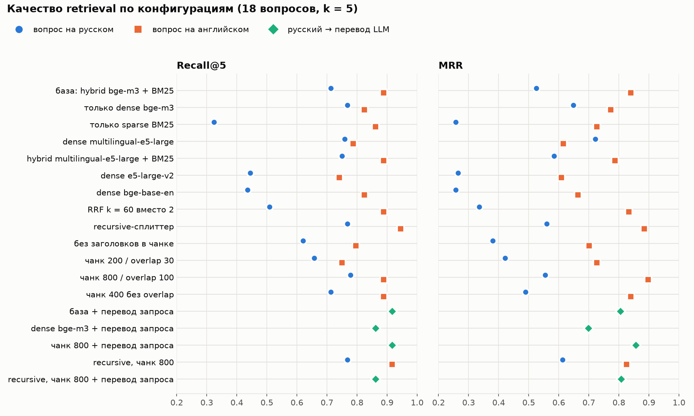

# Лабораторная работа №2 — RAG-агент по научным статьям

## Описание задания

RAG-агент отвечает на вопросы о четырёх статьях arXiv по диффузионным моделям: находит релевантные
фрагменты в векторной базе Qdrant и формирует ответ с цитатами (статья, раздел, страница, сниппет)
с помощью LLM из лабораторной №1. Конвейер: PDF → нормализованный Markdown → чанки → dense/sparse
эмбеддинги → Qdrant (HNSW) → оценка retrieval на 18 вопросах с эталоном → RAG-сервис.

Подробное описание решений, экспериментов и разбор ошибок — в **[DESIGN.md](DESIGN.md)**.

## Коротко о результатах

| | Recall@5 | Recall@10 | MRR |
|---|---|---|---|
| Вопросы на русском, база (hybrid, 400 токенов) | 0.713 | 0.861 | 0.525 |
| Вопросы на русском, **итог** (hybrid, 800 токенов, перевод запроса) | **0.917** | **0.972** | **0.856** |
| Вопросы на английском, **итог** | **0.889** | **0.972** | **0.897** |

- **Язык — главный фактор.** Корпус англоязычный, вопросы — русские. Английские модели эмбеддингов
  и BM25 находят на русских вопросах в 1.7–2.7 раза меньше (R@5 0.32–0.44 против 0.74–0.86).
  Мультиязычная bge-m3 держит 0.77–0.82 на обоих языках, а **перевод запроса той же LLM** поднимает
  русские вопросы до уровня английских.
- **Заголовки в тексте чанка** («Direct3D | 4 Experiments > 4.1 Implementation Details») — самый
  дешёвый и один из самых сильных параметров: без них R@5 падает на 0.09.
- **Чанк 800 токенов** — лучший MRR: в маленьком корпусе (84 чанка) факт и его контекст
  оказываются в одном фрагменте.
- **Чанкер — готовые сплиттеры LangChain** (`MarkdownHeaderTextSplitter` + `RecursiveCharacterTextSplitter`).
  Итог с ними не хуже собственной реализации из первой версии: на русских вопросах R@5 0.917 против
  0.889.
- **Ответы**: все 18 со ссылками на нужную статью, в 17 из 18 процитирован фрагмент с
  доказательством; оба вопроса вне корпуса получили отказ. Ответ — за ~2.1 с на RTX 5070.
- **HNSW и квантование int8** на 132 векторах не отличаются от точного перебора.



## Использованные технологии и модели

| Компонент | Что использовано |
|---|---|
| LLM | **Ministral-3-8B-Instruct-2512** Q4_K_M из лабораторной №1 (лучший баланс качества и скорости), llama.cpp `llama-server` b11524, OpenAI-совместимый API |
| Векторная БД | **Qdrant 1.20** — бинарник с GitHub Releases (без Docker и root), `qdrant-client` 1.20 |
| Dense-эмбеддинги | **BAAI/bge-m3** (итог), intfloat/multilingual-e5-large, intfloat/e5-large-v2, BAAI/bge-base-en-v1.5 — sentence-transformers, fp16 на GPU |
| Sparse | **BM25**: насыщенная частота терминов считается на клиенте, IDF — в Qdrant (`modifier=IDF`) |
| Парсинг PDF | **pymupdf4llm 1.28.2** + собственная нормализация |
| Чанкинг | **langchain-text-splitters 1.1**: `MarkdownHeaderTextSplitter`, `RecursiveCharacterTextSplitter` с токенизатором bge-m3 |
| Окружение | Python 3.14, PyTorch 2.11 (CUDA 12.8), transformers, matplotlib; Ryzen 9 9950X, 64 GB RAM, RTX 5070 12 GB |

## Результаты работы

### 1. Корпус и вопросы

| Статья | arXiv | Страниц |
|---|---|---|
| Direct3D: Scalable Image-to-3D Generation via 3D Latent Diffusion Transformer | [2405.14832](https://arxiv.org/abs/2405.14832) | 15 |
| ViewCrafter: Taming Video Diffusion Models for High-fidelity Novel View Synthesis | [2409.02048](https://arxiv.org/abs/2409.02048) | 13 |
| DreamPainter: Image Background Inpainting for E-commerce Scenarios | [2508.02155](https://arxiv.org/abs/2508.02155) | 13 |
| Preserving Product Fidelity in Large Scale Image Recontextualization with Diffusion Models | [2503.08729](https://arxiv.org/abs/2503.08729) | 12 |

53 страницы, ~19.5 тыс. слов после очистки. [`questions.json`](source/questions.json) — 18 вопросов
(по 4 на статью и 2 межстатейных) на русском с английским переводом. У каждого вопроса есть
статьи-источники, дословные фразы-доказательства из текста (эталон для retrieval), ключевые
факты и эталонный ответ.

### 2. PDF → Markdown — [`parse_pdf.py`](source/parse_pdf.py)

pymupdf4llm правильно читает двухколоночную вёрстку и таблицы, а `pdftotext -layout` склеивает строки
соседних колонок. Нормализация поверх него:

- **уровни заголовков** восстанавливаются по номеру раздела (`3` → h2, `3.1` → h3, `A.2.1` → h4):
  pymupdf4llm назначает их по размеру шрифта, и уровни у разных статей не совпадают;
- **маркеры страниц** `<!-- page: N -->` — из них чанк получает номера страниц для цитат;
- **YAML-шапка**: название, авторы, arXiv id, URL, путь к PDF, дата публикации и разбора, число страниц;
- **удаляются** колонтитулы, метка arXiv, список литературы (шум для BM25) и «текст картинок» —
  подписи узлов диаграмм.

Результат — [`source/data/markdown/`](source/data/markdown/). Известные дефекты: дроби в формулах
теряют вёрстку (`1/512` → `5121`), диакритика отделяется (`Pl¨ucker`).

### 3. Чанки и эмбеддинги — [`build_index.py`](source/build_index.py)

Чанкинг — готовые сплиттеры **langchain-text-splitters**:

- **`markdown`**: `MarkdownHeaderTextSplitter` делит статью на разделы h1–h3, затем
  `RecursiveCharacterTextSplitter` режет длинные разделы на окна;
- **`recursive`**: `RecursiveCharacterTextSplitter` идёт по всей статье, раздел чанка — последний
  заголовок перед ним.

Размер окна и overlap считаются в токенах токенизатора bge-m3. Страницы чанка восстанавливаются по
его положению относительно маркеров страниц. Встроенный `add_start_index` для этого не годится: после
склейки кусков он возвращает −1, поэтому чанк находится в тексте по первой и последней строке.
С `--headers` в текст для векторизации добавляется строка «Статья | Раздел > Подраздел».

Параметры задаются флагами, переменными `RAG_*` или берутся по умолчанию из
[`config.py`](source/config.py):

```bash
python build_index.py --splitter markdown --chunk-size 800 --overlap 100 --headers \
                      --vectors hybrid --model bge-m3        # dense | sparse | hybrid
```

Артефакты пишутся в `artifacts/<index_id>/`, например `markdown-c800-o100-h-hybrid-bge-m3/`:
чанки, `dense.npy`, BM25-веса и `config.json` с параметрами и хэшем корпуса. Повторный запуск
ничего не пересчитывает, пока не изменились параметры или Markdown.

### 4. Qdrant — [`load_to_vector_store.py`](source/load_to_vector_store.py)

Коллекция `papers-<index_id>`: dense-вектор `dense` (cosine, HNSW `m=16`, `ef_construct=100`,
опционально int8-квантование), sparse-вектор `bm25` с IDF, payload — статья, раздел, страницы, URL,
текст. Пороги индексации снижены до минимальных 10 KB, иначе Qdrant обслуживал бы маленькую
коллекцию перебором и HNSW не строился бы.

- **Идемпотентность**: id точки — UUID5 от id чанка. Если коллекция актуальна, запись пропускается.
  Если параметры индекса или корпус изменились — загрузчик останавливается и требует
  `--drop-and-reindex`.
- **Флаги**: `--hnsw-m`, `--ef-construct`, `--quantization`, `--rebuild`, `--drop-and-reindex`,
  `--reset`, `--reset-all`.

### 5. Оценка retrieval — [`evaluate.py`](source/evaluate.py)

Чанк считается релевантным, если он из нужной статьи и содержит фразу-доказательство. Такой эталон
не зависит от разбиения, поэтому один и тот же набор вопросов сравнивает любые конфигурации.
k = 5 и 10, каждая конфигурация проверяется на русских и английских формулировках. Полная таблица
с P@k и Hit@k — [`results/retrieval.md`](source/results/retrieval.md).

| Конфигурация (меняется один параметр относительно базы) | ru R@5 | ru MRR | en R@5 | en MRR |
|---|---|---|---|---|
| **база**: markdown, 400/60, заголовки, hybrid bge-m3 + BM25 | 0.713 | 0.525 | 0.889 | 0.840 |
| только dense bge-m3 | 0.769 | 0.649 | 0.824 | 0.773 |
| только sparse BM25 | 0.324 | 0.257 | 0.861 | 0.727 |
| dense multilingual-e5-large | 0.759 | 0.722 | 0.787 | 0.615 |
| dense e5-large-v2 | 0.444 | 0.265 | 0.741 | 0.609 |
| dense bge-base-en | 0.435 | 0.257 | 0.824 | 0.663 |
| RRF k = 60 вместо 2 | 0.509 | 0.335 | 0.889 | 0.833 |
| recursive-сплиттер | 0.769 | 0.560 | **0.944** | 0.884 |
| без заголовков в чанке | 0.620 | 0.381 | 0.796 | 0.701 |
| чанк 200 / overlap 30 | 0.657 | 0.421 | 0.750 | 0.727 |
| чанк 800 / overlap 100 | 0.778 | 0.555 | 0.889 | **0.897** |
| чанк 400 без overlap | 0.713 | 0.490 | 0.889 | 0.840 |
| база + перевод запроса | **0.917** | 0.806 | — | — |
| recursive, чанк 800 + перевод запроса | 0.861 | 0.807 | — | — |
| **чанк 800 + перевод запроса (итог)** | **0.917** | **0.856** | 0.889 | **0.897** |

HNSW (точный перебор; `m` 4–16; `ef` 4–64) и квантование int8 на 132 векторах дают одинаковые
метрики. Латентность поиска ~7 мс, почти вся она уходит на эмбеддинг запроса.

### 6. RAG-движок — [`rag.py`](source/rag.py)

1. Русский запрос переводится на английский той же LLM.
2. Запрос векторизуется bge-m3 и BM25.
3. Qdrant выполняет гибридный поиск (prefetch dense + sparse → RRF), возвращает top-5 фрагментов.
4. Собирается промпт: инструкция «отвечай только по фрагментам, ставь ссылки [n], иначе скажи, что
   ответа нет» + пронумерованные фрагменты с разделом и страницами + вопрос.
5. Ministral-3-8B отвечает, ссылки `[n]` превращаются в список источников со сниппетом.

```text
$ python rag.py "Какой сэмплер, сколько шагов и какой guidance scale используются при инференсе Direct3D?"

При инференсе **D3D-DiT** в Direct3D используется **DDIM sampler** с **50 шагами** и **guidance scale** равным **7.5** [1].

Источники:
  [1] Direct3D (arXiv:2405.14832), 4 Experiments > 4.1 Implementation Details, стр. 7, 8
      «During inference, we apply 50 steps of DDIM [48] with the guidance scale set to 7.5.»

поисковый запрос: Which sampler, how many steps, and what guidance scale are used during Direct3D inference?
поиск 4.155 с, генерация 1.0 с
```

«поиск» в разовом запуске включает загрузку bge-m3 и перевод; в работающем сервисе — ~0.25 с на
перевод и ~7 мс на поиск.

Режимы: один вопрос, интерактивный диалог (`python rag.py`), HTTP-сервис
(`python rag.py --serve 8000`, `POST /ask {"question": "..."}` → JSON с ответом, цитатами,
найденными фрагментами и таймингами).

**Качество ответов** ([`evaluate_qa.py`](source/evaluate_qa.py), все ответы —
[`results/qa_answers.md`](source/results/qa_answers.md)):

| Метрика | База: 400 токенов, без перевода | Итог: 800 токенов + перевод |
|---|---|---|
| ключевые факты в ответе | 0.74 | 0.83 |
| цитаты из нужной статьи | 1.00 | 1.00 |
| среди цитат есть фрагмент-доказательство | 0.78 | 0.94 |
| отказ на 2 вопросах вне корпуса | 2/2 | 2/2 |
| токенов промпта / генерация | 1478 / 1.9 с | 2286 / 2.1 с |

## Выводы

1. **Для русских вопросов к английскому корпусу нужна мультиязычность — моделью или переводом.**
   Перевод запроса оказался сильнее смены модели: MRR базы растёт с 0.525 до 0.806, а
   мультиязычная multilingual-e5-large даёт 0.722. Перевод стоит одного вызова LLM (~0.25 с) и
   возвращает гибриду пользу от BM25, которому на русском тексте не с чем совпадать.
2. **Структура документа — бесплатный сигнал.** Заголовки в тексте чанка дают больше, чем подбор
   overlap: без заголовков чанк «50 steps of DDIM» не знает, что он из Direct3D. Overlap у
   LangChain переносит только целые абзацы и почти не влияет на метрики (400/0 и 400/60 на
   английских вопросах совпадают).
3. **Гибрид не всегда лучше dense.** На русских вопросах без перевода шумная выдача BM25 портит
   хорошую dense-выдачу (MRR 0.649 → 0.525). Сильно влияет k в RRF: при классическом k = 60
   R@5 на русских падает до 0.509; оставлен k = 2 (значение Qdrant по умолчанию).
4. **Параметры HNSW на корпусе в сотню чанков ни на что не влияют.** Они станут важны на 10⁴+
   векторах; квантование int8 на этом корпусе не меняет выдачу.
5. **Проблемы, найденные и исправленные по ходу работы** (подробности — в
   [DESIGN.md](DESIGN.md)):
   - **пустой пакет на PyPI**: `pymupdf4llm 2.0` не содержит кода; версия закреплена на 1.28.2;
   - **плавающие метрики hybrid**: RRF давал ничьи при «зеркальных» рангах, и Qdrant возвращал
     такие фрагменты в произвольном порядке. Веса 1.0 / 0.99 сделали порядок детерминированным —
     два прогона оценки совпадают;
   - **плавающий BM25**: повторный upsert тех же точек временно искажал IDF; теперь актуальная
     коллекция не перезаписывается;
   - **«переводчик» отвечал на вопрос**: про Direct3D он рассказывал о графическом API Microsoft.
     Retrieval при этом работал, и метрики дефекта не показали — нашёлся при просмотре запросов.
     Исправлено разметкой `<query>`, явным «do not answer» и примерами;
   - **ответы LLM различались между прогонами** даже при `temperature = 0`: llama-server
     переиспользовал кэш промпта. После отключения `cache_prompt` ответы воспроизводимы;
   - **ссылки статей на литературу** (`[35, 34]`) LLM выдавала за цитаты — они вырезаются из
     контекста;
   - **`add_start_index` в LangChain возвращал −1** после склейки кусков, и чанки получали
     неверные страницы (DDIM — 7 вместо 8); положение чанка теперь ищется по его первой и последней
     строке.
6. **Оставшиеся ошибки**:
   - retrieval: чанк с «DynamiCrafter» на 9-м месте при top-5;
   - перекос выдачи в межстатейном вопросе: 4 из 5 фрагментов из одной статьи;
   - краткость ответов: модель опускает часть чисел (ранг LoRA 256, 1800 шагов);
   - парсинг формул.

   Следующие шаги: реранкер, диверсификация выдачи по статьям, парсер формул, LLM-судья.

## Инструкция по запуску

1. **Окружение** (Python ≥ 3.12, GPU с CUDA желательна):
   ```bash
   python -m venv .venv && . .venv/bin/activate
   pip install torch --index-url https://download.pytorch.org/whl/cu128
   pip install -r source/requirements.txt
   ```
2. **Qdrant** — скачать `qdrant-x86_64-unknown-linux-gnu.tar.gz` из
   [GitHub Releases](https://github.com/qdrant/qdrant/releases) и запустить:
   ```bash
   QDRANT__STORAGE__STORAGE_PATH=~/llms/qdrant/storage ./qdrant      # http://127.0.0.1:6333
   ```
3. **LLM** — llama-server из лабораторной №1:
   ```bash
   llama-server -m ministral3-8b/Ministral-3-8B-Instruct-2512-Q4_K_M.gguf -c 8192 -ngl 99 -fa on --port 8080
   ```
4. **Индекс** (из каталога `source/`):
   ```bash
   python parse_pdf.py              # скачать PDF с arXiv → data/markdown/*.md
   python build_index.py            # итоговая конфигурация → artifacts/
   python load_to_vector_store.py   # → коллекция Qdrant
   ```
5. **Вопросы**:
   ```bash
   python rag.py "Как устроено двухэтапное обучение DreamPainter?"
   python rag.py                    # диалог
   python rag.py --serve 8000       # HTTP: curl -X POST localhost:8000/ask -d '{"question": "..."}'
   ```
6. **Оценка** (пересоберёт и загрузит все конфигурации сама):
   ```bash
   python evaluate.py               # → results/retrieval.{md,json}
   python evaluate_qa.py            # → results/qa_answers.md, results/qa.json
   python evaluate_qa.py --chunk-size 400 --overlap 60 --no-translate --tag _baseline
   python plot_results.py           # → results/plots/retrieval.png
   ```

Адреса сервисов меняются переменными `QDRANT_URL` и `LLM_URL`, параметры индекса — `RAG_SPLITTER`,
`RAG_CHUNK_SIZE`, `RAG_OVERLAP`, `RAG_HEADERS`, `RAG_VECTORS`, `RAG_MODEL`, `RAG_TRANSLATE`.

### Структура

```
lab2/
├── README.md                  отчёт
├── DESIGN.md                  проектный документ: решения, эксперименты, разбор ошибок
└── source/
    ├── config.py              корпус, пути, модели, параметры индекса
    ├── parse_pdf.py           PDF → Markdown
    ├── chunking.py            разбиение на чанки (langchain-text-splitters)
    ├── encoders.py            dense-эмбеддинги и BM25
    ├── build_index.py         чанки + эмбеддинги → artifacts/
    ├── load_to_vector_store.py  загрузка в Qdrant, переиндексация, сброс
    ├── retriever.py           dense / sparse / hybrid-поиск, перевод запроса
    ├── rag.py                 RAG-движок: CLI, диалог, HTTP
    ├── evaluate.py            метрики retrieval по конфигурациям
    ├── evaluate_qa.py         качество ответов
    ├── plot_results.py        график
    ├── questions.json         18 вопросов с эталоном
    ├── requirements.txt
    ├── data/markdown/         нормализованный корпус (PDF скачиваются в data/pdf/)
    └── results/               таблицы, ответы, график
```
